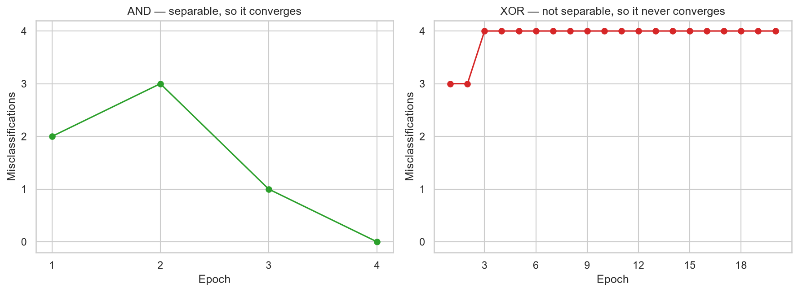
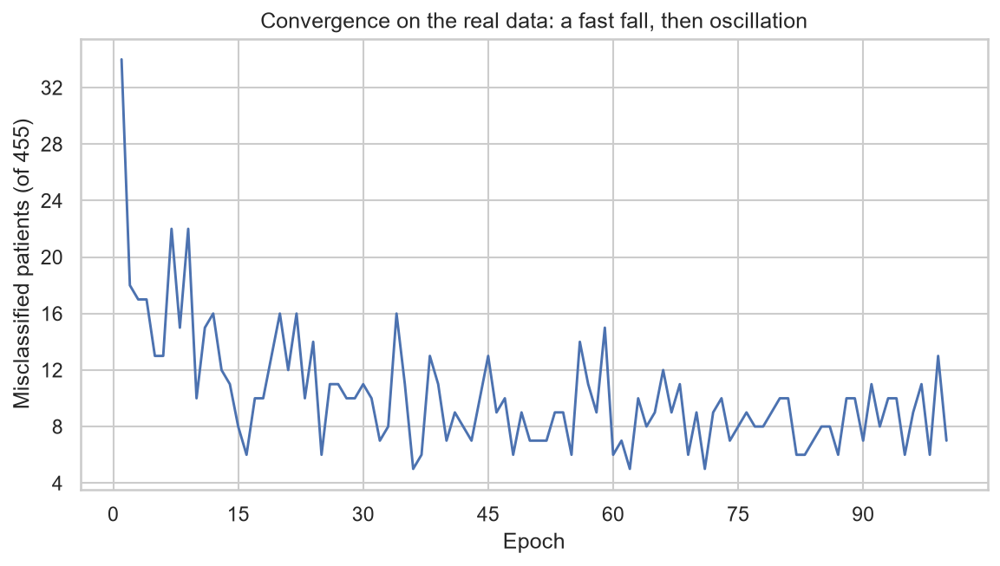
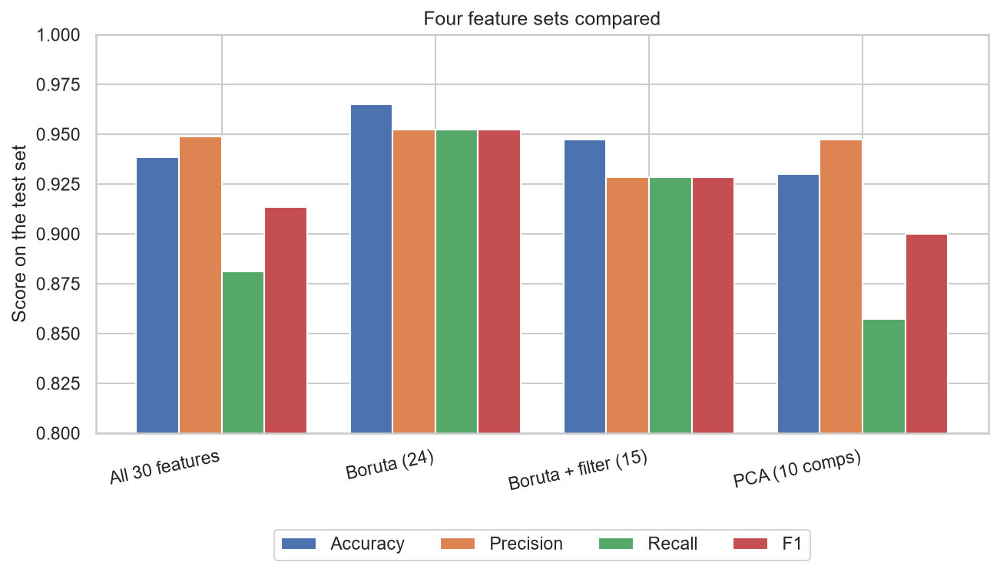
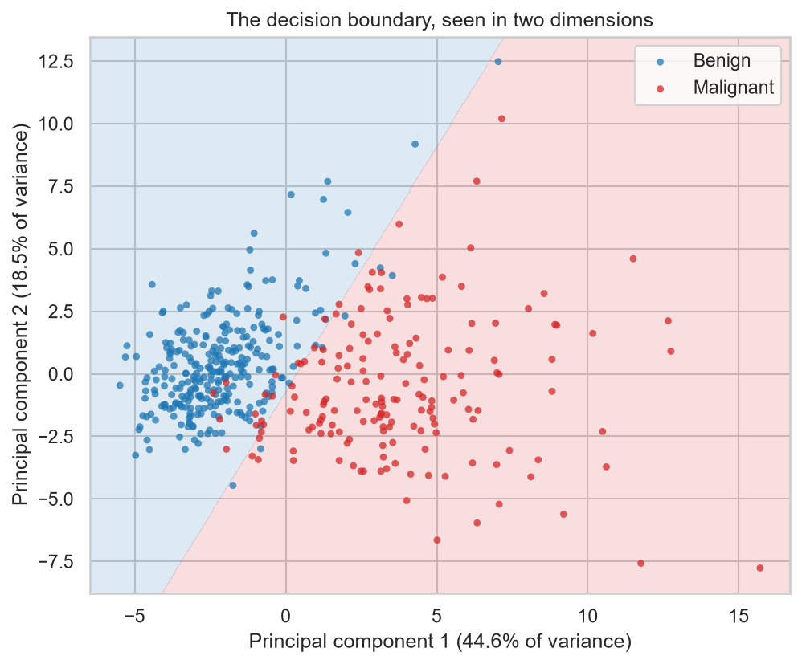

# Building Perceptron

**Classifying breast tumours with a single artificial neuron, written from scratch.**

La Plateforme — Rooney Nofal

---

A [Perceptron](https://en.wikipedia.org/wiki/Perceptron) — the first artificial neuron,
invented by Frank Rosenblatt in 1958 — implemented from scratch in NumPy and applied to
the **Breast Cancer Wisconsin (Diagnostic)** dataset.

No machine-learning library provides the model. `scikit-learn` is used only for supporting
work: splitting, scaling, feature selection and metrics. The classifier itself is about
thirty lines of our own code in [`perceptron.py`](perceptron.py).

**Headline result: 96.5% accuracy and 95.2% recall on unseen patients**, with 2 of 42
malignant cases missed.

---

## Repository contents

| File | What it is |
| --- | --- |
| [`perceptron.py`](perceptron.py) | The `Perceptron` class — the model, written from scratch |
| [`building_perceptron.ipynb`](building_perceptron.ipynb) | The full analysis: validation, cleaning, exploration, reduction, modelling, evaluation |
| `README.md` | This file |
| `requirements.txt` | The six libraries needed to run it |
| [`docs/theory.md`](docs/theory.md) | The full written research, with sources cited **section by section** |
| `data/` | The raw dataset and its description, unmodified |
| `figures/` | Every plot the notebook produces, saved as PNG |

> The theory below is the condensed version. [`docs/theory.md`](docs/theory.md) gives the
> same material in full, with a *"Sources for this section"* block under every answer so any
> single claim can be traced to the paper that supports it.

---

## 1. Project context

### What the project asks

Build a Perceptron from scratch in Python using object-oriented programming, test it on
randomly generated data, then apply it to a real medical classification problem — cleaning
and exploring the data, reducing its dimensionality, modelling it, evaluating the result
and proposing improvements.

### Machine Learning and Deep Learning

**Artificial Intelligence ⊃ Machine Learning ⊃ Deep Learning** — they are nested, not
competing.

**Machine Learning** is the study of programs that improve at a task by being exposed to
data rather than following hand-written rules. Tom Mitchell's standard definition: *"A
computer program is said to learn from experience E with respect to some class of tasks T
and performance measure P, if its performance at tasks T, as measured by P, improves with
experience E."* Here **E** is the 569 patient records, **T** is classifying a tumour, and
**P** is how often that classification is right.

**Deep Learning** is the part of Machine Learning built on neural networks with several
layers between input and output. "Deep" refers to that depth and nothing more.

**The difference that produces all the others: who chooses the features.**

| Criterion | Classical Machine Learning | Deep Learning |
| --- | --- | --- |
| Who chooses the features | A human expert designs them | The network learns them from raw data |
| Data it suits | Structured, tabular | Unstructured: images, audio, text |
| Data needed | Hundreds of examples | Tens of thousands and up |
| Computing power | An ordinary CPU, seconds | Normally a GPU, hours to weeks |
| Parameters | Tens to thousands | Millions to billions |
| Interpretability | Often readable | Largely opaque |

Every row follows from the first. Ask a network to discover its own features and it needs
more parameters, which needs more data, which needs more computation — and the features it
invents have no name in our language, which is why the result is hard to read. So "Deep
Learning is more powerful" is the wrong summary. The accurate one: **Deep Learning moves
the work of designing features from the human to the machine, and pays for it in data,
computation and transparency.**

### When to use one rather than the other

Four questions settle it: *What shape is the data? How much is there? Does anyone need to
understand the decision? What can you afford?*

Applied here: our data is tabular, small (569 rows), medical — so interpretability matters
— and trains in milliseconds on a CPU. All four point to classical Machine Learning.

It is worth noticing *why* the data looks like this. These 30 features are the output of a
feature-engineering step someone already performed: researchers took digitised images of
fine needle aspirates and measured radius, texture, concavity and seven other properties
of each cell nucleus. Had we been handed the original images, that step would be ours — and
taking over that step is precisely what Deep Learning exists to do.

Deep Learning is also not automatically better on tabular data: Grinsztajn et al. (2022)
benchmarked both families across many tabular datasets and found tree-based models still
outperform deep networks there.

### Three applications of Deep Learning

| Application | What it does | Why it needed Deep Learning |
| --- | --- | --- |
| **AlphaFold** | Predicts a protein's 3D structure from its amino acid sequence, at accuracy competitive with laboratory methods. Over 200 million structures published. Awarded the 2024 Nobel Prize in Chemistry. | Nobody knew which patterns in a sequence determine folding, so there was no feature list to hand a classical model |
| **Diabetic retinopathy screening** | A network trained on ~128,000 retinal photographs matched a panel of ophthalmologists at detecting a leading cause of preventable blindness | The input is a raw photograph; the signs that matter are tiny and hard to express as numeric rules |
| **The Transformer** | Replaced sequential text processing with an attention mechanism weighing every word against every other. The architecture under every modern large language model | The meaning of a sentence is not a list of measurable properties |

The second is a useful contrast with this project: deep learning is the right tool for
cancer detection **from images**; our data is already a table of expert-measured features,
which is a different problem.

### What a Perceptron is

A **supervised binary classifier**: it takes a list of numbers, combines them into one
score, and answers one of two classes.

**The biological analogy.** A neuron receives signals through its dendrites; each synapse
has a strength; the cell body integrates everything arriving; if the total crosses a
threshold the neuron fires, all-or-nothing. Learning is largely a change in synaptic
strengths.

| Biological neuron | Perceptron |
| --- | --- |
| Incoming signals | Inputs x₁ … xₙ |
| Synaptic strength | Weights w₁ … wₙ |
| Excitatory / inhibitory | Positive / negative weight |
| Cell body integrating | Weighted sum z = w·x + b |
| Firing threshold | Activation function |
| All-or-nothing impulse | Output: 1 or 0 |

It is an inspiration, not a simulation — a real neuron is vastly more complex.
**McCulloch & Pitts (1943)** built the first mathematical neuron, but its weights were set
by hand. **Rosenblatt (1958)** added the missing piece: a rule that learns the weights from
examples. *The invention is the learning rule, not the neuron.*

### The mathematics

**Stage 1 — the net input:**

```
z = w₁x₁ + w₂x₂ + … + wₙxₙ + b
```

| Term | Meaning |
| --- | --- |
| x₁ … xₙ | The inputs — for us, 30 measurements of one tumour |
| w₁ … wₙ | One weight per feature. **These are what the model learns** |
| b | The bias: a constant that shifts the boundary away from the origin |
| z | The net input — any real number |

**Stage 2 — the decision:**

```
ŷ = 1  if z ≥ 0
ŷ = 0  if z <  0
```

Setting `z = 0` defines the **decision boundary**: a line in 2D, a plane in 3D, a
29-dimensional hyperplane here. The Perceptron's entire job is to place **one flat boundary**
between the two classes. With 30 features that is **31 numbers to learn** — against the
millions of a deep network, and each one readable.

### The learning rule

```
error = y − ŷ
wᵢ ← wᵢ + η · (y − ŷ) · xᵢ
b  ← b  + η · (y − ŷ)
```

where η is the **learning rate**. Since y and ŷ are each 0 or 1, the error takes only three
values:

| Situation | Error | What happens |
| --- | --- | --- |
| Correct | 0 | Nothing at all |
| Missed a positive | +1 | Weights move **toward** this example |
| False alarm | −1 | Weights move **away** from it |

**The Perceptron learns only from its mistakes.** A correct prediction changes nothing.

The update is provably in the right direction: adding `η·x` to the weights increases the
next net input by `η(x·x + 1)`, which is always positive.

**Novikoff (1962)** proved the consequence: *if the classes are linearly separable the rule
converges in a finite number of updates; if they are not, it never settles.* Other rules
exist — the **delta rule** (Widrow & Hoff, 1960), which uses the continuous score and so
works by gradient descent, and the **pocket algorithm** (Gallant), which keeps the best
weights seen.

### The activation function

The **Heaviside step function** — 1 when z ≥ 0, else 0. It converts a score into a decision,
the mathematical equivalent of the biological threshold.

Its flaw is decisive: **its derivative is zero everywhere.** Gradient descent asks "how does
the error change if I nudge this weight?" and the step function always answers "not at all",
because the output does not move until it jumps. That is why the Perceptron needs its own
purpose-built rule, and why it cannot be stacked into deep networks. Sigmoid, tanh and ReLU
replaced it precisely because they are differentiable.

### The training process

```
Initialise the weights and bias
Repeat for each epoch:
    errors = 0
    For each example (x, y):
        z     = w · x + b
        ŷ     = step(z)
        error = y − ŷ
        If error ≠ 0:
            w = w + η · error · x
            b = b + η · error
            errors += 1
    Record errors
    If errors == 0: stop — the data is separated
```

An **epoch** is one complete pass. More than one is needed because correcting one example
can break another. Updates are applied immediately, one example at a time — *online*
learning. Recording the error count per epoch gives the **convergence curve**, the single
most informative diagnostic we have.

### The limitations

Everything below follows from one fact: **the boundary is flat.**

The classic demonstration is **XOR**. Its two 1s sit at opposite corners and its two 0s at
the other opposite corners — the classes are interleaved diagonally and no straight line
separates them. AND and OR, barely simpler, are learned in a few epochs.



*Left: AND converges in four epochs. Right: XOR never does, and never would.*

Minsky and Papert analysed these limits in *Perceptrons* (1969), a book often credited with
triggering the first "AI winter". That narrative deserves a caveat: they did not claim
multi-layer networks were useless, only that no learning algorithm for them was then known.
Backpropagation (Rumelhart, Hinton & Williams, 1986) supplied it, and a two-layer network
solves XOR trivially.

| Limitation | What solved it |
| --- | --- |
| Linear boundaries only | Multi-layer networks with backpropagation |
| Never converges on non-separable data | The pocket algorithm, or the delta rule |
| No probability output | Logistic regression — a sigmoid instead of a step |
| Sensitive to feature scale | Standardisation before training |
| Binary only | One-vs-rest, or a multi-output layer |
| No notion of margin | Support Vector Machines, which maximise it |

---

## 2. The data and its analysis

### The dataset

**Breast Cancer Wisconsin (Diagnostic)** — 569 breast masses. For each, a digitised image of
a fine needle aspirate was analysed and ten properties of the cell nuclei measured: radius,
texture, perimeter, area, smoothness, compactness, concavity, concave points, symmetry and
fractal dimension. Each is reported three ways — mean, standard error (`_se`) and worst
(largest) value — giving **30 numeric features** per patient. The target is the diagnosis:
malignant or benign.

### Cleaning

| Problem found | Action taken | Why |
| --- | --- | --- |
| `Unnamed: 32` — 569 missing values of 569 | Dropped | The raw CSV's header ends with a stray comma, so pandas invents an empty column |
| `id` — a patient identifier | Dropped | A number with no medical meaning; the model would learn from an accident of record-keeping |
| `diagnosis` — text `M` / `B` | Encoded **M = 1, B = 0** | The model does arithmetic. Malignant is the *positive* class, so "recall" means "share of real cancers caught" |

No missing values and no duplicate rows remained after cleaning: 569 patients × 30 features.

### What the exploration showed

**Class balance — 357 benign, 212 malignant (63% / 37%).** Not severe, but real: answering
"benign" to every patient scores 63% without learning anything, so accuracy has to be judged
against that floor, and the train/test split must be stratified.

**Feature scales differ by five orders of magnitude.** `area_worst` reaches ~4250;
`fractal_dimension_se` stays around 0.03. This matters enormously: the learning rule adds
`η · error · xᵢ`, so correction size is proportional to the feature's own value. Left
untreated, the large-valued features would dominate entirely — not because they matter
medically, but because of the units they happen to be recorded in. **This is the single
most common way this project fails.**

**21 pairs of features are correlated above 0.9.** That is geometry, not coincidence: radius,
perimeter and area are three ways of measuring the same circle, and the relationship repeats
across the `_mean`, `_se` and `_worst` versions of every measurement.

**Some features separate the classes well, some barely.** `concave points_mean`,
`radius_mean` and `area_worst` show clearly displaced distributions between the two classes;
`smoothness_mean` and `texture_mean` overlap heavily.

### Preprocessing

**Split first, then scale** — in that order, and the order is not cosmetic. The scaler learns
a mean and a standard deviation from the data it is fitted on. Fitting it on all 569 patients
before splitting would leak test-set information into training and make every score
afterwards quietly optimistic.

- Stratified 80/20 split: **455 training patients** (37.4% malignant), **114 test patients**
  (36.8% malignant)
- `StandardScaler` fitted on the training set only, then applied to the test set

### Dimensionality reduction

Three approaches, compared honestly.

**Boruta** (Kursa & Rudnicki, 2010) asks one question per feature: *does this carry more
information than pure noise?* Every column is duplicated and the copy shuffled, creating a
**shadow feature** with the same distribution but no connection to the diagnosis. A Random
Forest measures importance; a real feature scores a **hit** when it beats the best shadow of
that round; a binomial test over many rounds decides Confirmed, Tentative or Rejected.

Result: **24 confirmed, 2 tentative, 4 rejected.** The four rejected were
`fractal_dimension_mean`, `texture_se`, `smoothness_se` and `symmetry_se`.

Boruta discards little by design — it is an *all-relevant* method, keeping every feature that
beats noise including redundant ones. The course material states this limitation directly:
*"Garde les variables redondantes ou corrélées : réduit peu la dimension."*

**A correlation filter**, which the same material recommends chaining afterwards: for every
pair correlated above 0.9, keep one. That took **24 features down to 15**.

**PCA** as a third comparison, building new composite features rather than selecting original
ones: **10 components explain 95% of the variance**, the first two alone 63.1%. Compact, but
no longer interpretable — "principal component 1" is not something a doctor can measure.

---

## 3. Modelling and results

Settings: learning rate 0.01, up to 100 epochs, fixed random seed.

### Convergence



Training used all 100 epochs and **never converged**. The error count fell from 34 to around
10 within a few passes, then oscillated between roughly 6 and 13 for the rest of training.

This is not a bug. It is Novikoff's theorem: the rule converges *if and only if* the classes
are linearly separable, and these are only *nearly* separable — a handful of malignant and
benign tumours have genuinely overlapping measurements.

### The four feature sets compared



| Feature set | Features | Accuracy | Precision | Recall | F1 | Specificity | Missed cancers |
| --- | --- | --- | --- | --- | --- | --- | --- |
| All 30 features | 30 | 93.86% | 94.87% | 88.10% | 91.36% | 97.22% | 5 |
| **Boruta** | **24** | **96.49%** | **95.24%** | **95.24%** | **95.24%** | **97.22%** | **2** |
| Boruta + correlation filter | 15 | 94.74% | 92.86% | 92.86% | 92.86% | 95.83% | 3 |
| PCA | 10 | 92.98% | 94.74% | 85.71% | 90.00% | 97.22% | 6 |

**Why recall is the metric that matters.** The two kinds of mistake are not equally serious.
A false positive — benign called malignant — leads to further tests and avoidable worry. A
false negative means a cancer goes undetected. Recall on the malignant class answers the
question that counts: *of all the real cancers, how many did we catch?*

### The three findings

1. **Removing features made the model better, not merely smaller.** Dropping Boruta's four
   rejected features raised recall from 88.1% to 95.2% and halved missed cancers from 5 to
   2. Those four were contributing noise, and a Perceptron weights every input it is given.

2. **Compactness has a real, modest cost.** The correlation filter cut 24 features to 15 —
   40% fewer — for one additional false negative. Worth stating plainly rather than
   glossing over.

3. **PCA performed worst**, as expected. It blends strongly predictive features together
   with noisy ones it cannot distinguish, and destroys interpretability in the process.

### The best model

Boruta's 24 features, on the 114 unseen test patients:

| | Predicted benign | Predicted malignant |
| --- | --- | --- |
| **Actually benign** | 70 | 2 |
| **Actually malignant** | 2 | 40 |



*The decision made visible, projected onto two principal components. The boundary is
perfectly straight because that is the only shape a Perceptron can draw — and the few points
on the wrong side of it are exactly the errors the convergence curve kept oscillating over.*

---

## 4. Tools used

| Tool | Role |
| --- | --- |
| **Python 3** | The language |
| **NumPy** | Array mathematics — the engine of the Perceptron class |
| **pandas** | Loading, cleaning and exploring the dataset |
| **Matplotlib** + **seaborn** | Every figure in the notebook |
| **scikit-learn** | Splitting, scaling, PCA and metrics — **not** the model |
| **Boruta** (`BorutaPy`) | All-relevant feature selection |
| **Jupyter** | The notebook |

The Perceptron itself uses **no library beyond NumPy**.

---

## 5. Conclusion

**The Perceptron is effective on this problem — more so than its age would suggest.** A model
from 1958, consisting of 31 learned numbers and about thirty lines of code, reached 96.5%
accuracy and 95.2% recall on unseen patients. It works because the problem suits it: these
classes are nearly linearly separable, which is exactly what the Perceptron requires.

**But it never converged**, and that has a concrete cost. The model returns the weights left
by the *final* epoch, which made 7 errors — while an epoch two passes earlier made only 6.
We are returning a slightly worse model than one we had already found, purely because of
where training happened to stop.

**The most interesting result was that feature selection improved the model rather than
merely compressing it.** Four noisy features were actively hurting a model that weights
everything it is given.

### Improvements, proposed but not implemented

| Problem observed | Proposed solution |
| --- | --- |
| Training oscillates; final weights worse than ones seen earlier | **The pocket algorithm** — keep and return the best weights seen |
| No probability, so no calibrated risk score | **Logistic regression** — a sigmoid in place of the step function |
| The boundary must be straight | **A multi-layer network** trained by backpropagation |
| The boundary may sit too close to the data | **A Support Vector Machine**, maximising the margin |
| A single split may be lucky | **Stratified k-fold cross-validation** |
| 2 missed cancers is 2 too many | **Class weighting or threshold tuning**, trading precision for recall |

**The honest summary.** The Perceptron is the right tool for understanding how a neuron
learns, and a reasonable one for this dataset. It would not be right for a clinical system —
not because 96.5% is too low, but because it cannot express uncertainty. A doctor needs to
know *how confident* a prediction is, and a step function has no way of saying.

---

## 6. How to run it

```bash
git clone https://github.com/rooney-nofal/building-perceptron.git
cd building-perceptron

python -m venv .venv
.\.venv\Scripts\Activate.ps1      # Windows PowerShell
# source .venv/bin/activate       # macOS / Linux

pip install -r requirements.txt
```

Then open `building_perceptron.ipynb` in VS Code or Jupyter and run all cells. The full
notebook executes in well under a minute.

---

## 7. Bibliography

- Bishop, C. M. (2006). *Pattern Recognition and Machine Learning*. Springer. [Free PDF](https://www.microsoft.com/en-us/research/publication/pattern-recognition-machine-learning/)
- Cortes, C., & Vapnik, V. (1995). "Support-vector networks." *Machine Learning*, 20(3), 273–297. [doi:10.1007/BF00994018](https://doi.org/10.1007/BF00994018)
- Dua, D., & Graff, C. *Breast Cancer Wisconsin (Diagnostic) Data Set*. UCI Machine Learning Repository. [Dataset](https://archive.ics.uci.edu/dataset/17/breast+cancer+wisconsin+diagnostic)
- Gallant, S. I. (1990). "Perceptron-based learning algorithms." *IEEE Transactions on Neural Networks*.
- Goodfellow, I., Bengio, Y., & Courville, A. (2016). *Deep Learning*. MIT Press. [Free online](https://www.deeplearningbook.org/)
- Grinsztajn, L., Oyallon, E., & Varoquaux, G. (2022). "Why do tree-based models still outperform deep learning on typical tabular data?" *NeurIPS 2022*. [arXiv:2207.08815](https://arxiv.org/abs/2207.08815)
- Gulshan, V., et al. (2016). "Development and Validation of a Deep Learning Algorithm for Detection of Diabetic Retinopathy in Retinal Fundus Photographs." *JAMA*, 316(22), 2402–2410. [doi:10.1001/jama.2016.17216](https://doi.org/10.1001/jama.2016.17216)
- Jumper, J., et al. (2021). "Highly accurate protein structure prediction with AlphaFold." *Nature*, 596, 583–589. [doi:10.1038/s41586-021-03819-2](https://doi.org/10.1038/s41586-021-03819-2)
- Kursa, M. B., & Rudnicki, W. R. (2010). "Feature Selection with the Boruta Package." *Journal of Statistical Software*, 36(11). [doi:10.18637/jss.v036.i11](https://doi.org/10.18637/jss.v036.i11)
- LeCun, Y., Bengio, Y., & Hinton, G. (2015). "Deep learning." *Nature*, 521(7553), 436–444. [doi:10.1038/nature14539](https://doi.org/10.1038/nature14539)
- McCulloch, W. S., & Pitts, W. (1943). "A logical calculus of the ideas immanent in nervous activity." *Bulletin of Mathematical Biophysics*, 5, 115–133. [doi:10.1007/BF02478259](https://doi.org/10.1007/BF02478259)
- Minsky, M., & Papert, S. (1969). *Perceptrons: An Introduction to Computational Geometry*. MIT Press.
- Mitchell, T. (1997). *Machine Learning*. McGraw-Hill.
- The Nobel Prize in Chemistry 2024. [nobelprize.org](https://www.nobelprize.org/prizes/chemistry/2024/summary/)
- Novikoff, A. B. (1962). "On convergence proofs on perceptrons." *Proceedings of the Symposium on the Mathematical Theory of Automata*, 12, 615–622. [DTIC](https://apps.dtic.mil/sti/tr/pdf/AD0298258.pdf)
- Rosenblatt, F. (1958). "The perceptron: a probabilistic model for information storage and organization in the brain." *Psychological Review*, 65(6), 386–408. [Full text](https://homepages.math.uic.edu/~lreyzin/papers/rosenblatt58.pdf)
- Rudin, C. (2019). "Stop explaining black box machine learning models for high stakes decisions and use interpretable models instead." *Nature Machine Intelligence*, 1, 206–215. [arXiv:1811.10154](https://arxiv.org/abs/1811.10154)
- Rumelhart, D. E., Hinton, G. E., & Williams, R. J. (1986). "Learning representations by back-propagating errors." *Nature*, 323, 533–536. [doi:10.1038/323533a0](https://doi.org/10.1038/323533a0)
- Samuel, A. L. (1959). "Some Studies in Machine Learning Using the Game of Checkers." *IBM Journal of Research and Development*, 3(3), 210–229. [Full text](https://people.csail.mit.edu/brooks/idocs/Samuel.pdf)
- Vaswani, A., et al. (2017). "Attention Is All You Need." *NeurIPS 2017*. [arXiv:1706.03762](https://arxiv.org/abs/1706.03762)
- Widrow, B., & Hoff, M. E. (1960). "Adaptive switching circuits." *IRE WESCON Convention Record*, Part 4, 96–104.
